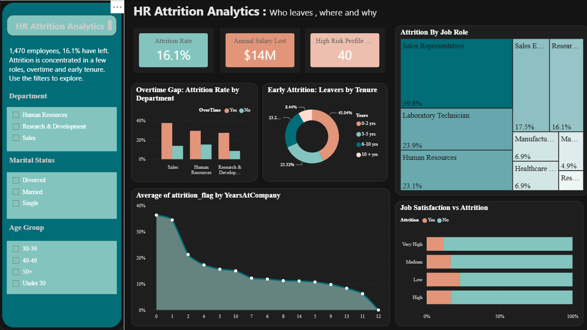

# HR Attrition Analytics Dashboard

A MySQL and Power BI project where I dig into IBM's HR attrition data to see who leaves, where they work, and what goes with leaving. The dashboard covers 1,470 employees, of whom 237 left (16.1%), representing about $14M in annual salary.

## What I wanted to find out

I started with a handful of simple questions an HR team would actually ask:

- How many people leave, and what share of the workforce is that?
- Which departments and job roles lose the most people?
- Do overtime, pay, age, tenure or travel make a real difference?
- Does job satisfaction or work-life balance matter?
- How many people leave early, and how much salary do leavers represent?
- Is there one kind of employee who is at much higher risk?

## Tools used

- MySQL for storing the data, quality checks and the SQL analysis
- Power Query for cleaning and adding flag columns
- Power BI Desktop for the dashboard (built-in aggregations, no DAX)
- The source data came in as a CSV file from Kaggle

## The dataset

Everything sits in one table called `hr_attrition_raw`. Each row is one employee. It has 35 columns, and these are the ones I used most:

| Column | What it holds |
|--------|---------------|
| EmployeeNumber | Unique employee ID |
| Attrition | Yes or No (did the employee leave) |
| Department | Sales, Human Resources or Research & Development |
| JobRole | Nine roles, from Sales Representative to Research Director |
| OverTime | Yes or No |
| Age | Employee age |
| MonthlyIncome | Monthly pay |
| YearsAtCompany | Tenure in years |
| YearsSinceLastPromotion | Years since the last promotion |
| MaritalStatus | Single, Married or Divorced |
| BusinessTravel | Non-Travel, Travel Rarely or Travel Frequently |
| JobSatisfaction | Rating from 1 to 4 |
| WorkLifeBalance | Rating from 1 to 4 |
| PerformanceRating | Rating (3 or 4 in this data) |
| Gender | Male or Female |

This is a fictional dataset made by IBM data scientists for learning, so the findings describe this data, not a real company.

Three columns have only one value for every employee: `EmployeeCount`, `Over18` and `StandardHours`. I removed them because a column that never changes can't explain anything.

## Cleaning the data

The data was already clean, so most of the work was checking it. In MySQL I confirmed:

1. 1,470 rows loaded
2. No duplicate employee numbers
3. No missing values in the key columns
4. Attrition only has the values Yes and No
5. Three columns hold a single value each

Then in Power Query, the applied steps, in order:

1. Source
2. Navigation
3. Removed Columns (`EmployeeCount`, `Over18`, `StandardHours`)
4. Added Conditional Column: `attrition_flag` (1 if Yes, else 0)
5. Added Conditional Columns for the bands and readable labels (age group, income band, tenure band, satisfaction, work-life balance, education)
6. Added Conditional Columns for the flags (`high_performer`, `low_satisfaction`, `stagnant_5yrs`, `leaver_annual_salary`, `early_leaver`, `high_risk_profile`)
7. Changed Type (flags set to Whole Number)

I never edited the raw table. The bands and labels were also built in a MySQL view (`vw_hr_clean`) so the SQL analysis used the same groups as the dashboard.

## Data model and measures

There is one flat table and no relationships, because the data describes a single thing: the employee.

I didn't write any DAX. The trick is the `attrition_flag` column, which is 1 for leavers and 0 for stayers. In a Power BI visual, the average of that column is the attrition rate and the sum is the number of leavers.

| What I wanted | Column | Summarize as |
|---------------|--------|--------------|
| Attrition rate | `attrition_flag` | Average |
| Employees who left | `attrition_flag` | Sum |
| Annual salary lost | `leaver_annual_salary` | Sum |
| Left within 2 years | `early_leaver` | Sum |
| High-risk profile rate | `attrition_flag` (filtered to `high_risk_profile` = 1) | Average |

## Headline numbers

| KPI | Value |
|-----|-------|
| Total employees | 1,470 |
| Employees who left | 237 |
| Current employees | 1,233 |
| Attrition rate | 16.1% |
| Annual salary of leavers | about $14M |
| Attrition of the high-risk profile | 67.5% (27 of 40) |

| Measure | Leavers | Stayers |
|---------|---------|---------|
| Average monthly income | 4,787 | 6,833 |
| Average tenure (years) | 5.1 | 7.4 |
| Average age | 33.6 | 37.6 |

## Exploring the data

### Overtime

| Overtime | Employees | Left | Attrition |
|----------|-----------|------|-----------|
| Yes | 416 | 127 | 30.5% |
| No | 1,054 | 110 | 10.4% |

### Department

| Department | Employees | Left | Attrition |
|------------|-----------|------|-----------|
| Sales | 446 | 92 | 20.6% |
| Human Resources | 63 | 12 | 19.0% |
| Research & Development | 961 | 133 | 13.8% |

### Job role

| Job Role | Employees | Left | Attrition |
|----------|-----------|------|-----------|
| Sales Representative | 83 | 33 | 39.8% |
| Laboratory Technician | 259 | 62 | 23.9% |
| Human Resources | 52 | 12 | 23.1% |
| Sales Executive | 326 | 57 | 17.5% |
| Research Scientist | 292 | 47 | 16.1% |
| Manufacturing Director | 145 | 10 | 6.9% |
| Healthcare Representative | 131 | 9 | 6.9% |
| Manager | 102 | 5 | 4.9% |
| Research Director | 80 | 2 | 2.5% |

### Tenure

| Tenure | Employees | Left | Attrition |
|--------|-----------|------|-----------|
| 0-2 years | 342 | 102 | 29.8% |
| 3-5 years | 434 | 60 | 13.8% |
| 6-10 years | 448 | 55 | 12.3% |
| 10+ years | 246 | 20 | 8.1% |

### Age group

| Age group | Employees | Left | Attrition |
|-----------|-----------|------|-----------|
| Under 30 | 326 | 91 | 27.9% |
| 30-39 | 622 | 89 | 14.3% |
| 40-49 | 349 | 34 | 9.7% |
| 50+ | 173 | 23 | 13.3% |

### Monthly income

| Income band | Employees | Left | Attrition |
|-------------|-----------|------|-----------|
| Below 3K | 395 | 113 | 28.6% |
| 3K-6K | 519 | 66 | 12.7% |
| 6K-10K | 275 | 33 | 12.0% |
| 10K+ | 281 | 25 | 8.9% |

### Marital status

| Marital status | Employees | Left | Attrition |
|----------------|-----------|------|-----------|
| Single | 470 | 120 | 25.5% |
| Married | 673 | 84 | 12.5% |
| Divorced | 327 | 33 | 10.1% |

### Business travel

| Business travel | Employees | Left | Attrition |
|-----------------|-----------|------|-----------|
| Travel Frequently | 277 | 69 | 24.9% |
| Travel Rarely | 1,043 | 156 | 15.0% |
| Non-Travel | 150 | 12 | 8.0% |

### Job satisfaction

| Job satisfaction | Employees | Left | Attrition |
|------------------|-----------|------|-----------|
| Low | 289 | 66 | 22.8% |
| Medium | 280 | 46 | 16.4% |
| High | 442 | 73 | 16.5% |
| Very High | 459 | 52 | 11.3% |

### Work-life balance

| Work-life balance | Employees | Left | Attrition |
|-------------------|-----------|------|-----------|
| Bad | 80 | 25 | 31.3% |
| Good | 344 | 58 | 16.9% |
| Better | 893 | 127 | 14.2% |
| Best | 153 | 27 | 17.6% |

### Gender

| Gender | Employees | Left | Attrition |
|--------|-----------|------|-----------|
| Male | 882 | 150 | 17.0% |
| Female | 588 | 87 | 14.8% |

### Overtime and job satisfaction together

| Overtime | Job satisfaction | Employees | Attrition |
|----------|------------------|-----------|-----------|
| Yes | Medium | 69 | 37.7% |
| Yes | Low | 84 | 35.7% |
| Yes | High | 121 | 33.9% |
| Yes | Very High | 142 | 21.1% |
| No | Low | 205 | 17.6% |
| No | High | 321 | 10.0% |
| No | Medium | 211 | 9.5% |
| No | Very High | 317 | 6.9% |

### Years since last promotion

| Group | Employees | Left | Attrition |
|-------|-----------|------|-----------|
| 0-4 years | 1,210 | 200 | 16.5% |
| 5+ years | 260 | 37 | 14.2% |

## Questions and answers

**How big is the attrition problem?**
237 of 1,470 employees left, which is 16.1%. Those leavers earned about $14M a year in salary.

**What matters most?**
Overtime. 30.5% of people working overtime left, against 10.4% of the rest, so about 2.9 times as often. Overtime workers are 28.3% of employees but 53.6% of all leavers (127 of 237).

**Which job roles lose the most people?**
Sales Representatives by far: 39.8% (33 of 83), about 2.5 times the company rate. Laboratory Technicians (23.9%) and Human Resources roles (23.1%) are next. Laboratory Technician has the most leavers by count (62).

**Which roles are the most stable?**
Senior ones. Research Director (2.5%), Manager (4.9%), and Manufacturing Director and Healthcare Representative (6.9% each).

**Which department is worst?**
Sales has the highest rate at 20.6%. Research & Development has the lowest rate (13.8%), but because it is the biggest department it still has the most leavers (133 of 237). Human Resources has only 63 employees, so its rate moves a lot with a few leavers.

**How many people leave early?**
102 leavers had 2 years or less at the company, which is 43.0% of all leavers. The 0-2 year group left at 29.8%, against 8.1% for people with 10+ years.

**Do younger or lower-paid employees leave more?**
Yes. Under 30 is 27.9% (38.4% of all leavers), and below 3K a month is 28.6% (47.7% of all leavers). Leavers earned about 30% less than stayers on average.

**What about marital status and travel?**
Single employees are half of all leavers (120 of 237, a 25.5% rate). Frequent travellers leave at 24.9%, about 3.1 times the rate of non-travellers (8.0%).

**Does job satisfaction matter?**
Mostly at the extremes. Low is 22.8% and Very High is 11.3%, but Medium (16.4%) and High (16.5%) are almost the same.

**Does work-life balance matter?**
It's not a clean trend. Bad is 31.3% but covers only 80 employees. Best (17.6%) is actually a bit higher than Better (14.2%).

**Is overtime or satisfaction the bigger factor?**
Overtime. Overtime workers with Very High satisfaction (21.1%) still leave more often than non-overtime workers with Low satisfaction (17.6%).

**Does a long wait for promotion cause people to leave?**
Not in this data. People 5+ years since their last promotion left at 14.2%, below the 16.1% company rate. Single years are noisy because the groups are small.

**Does gender matter?**
Only slightly: 17.0% for men and 14.8% for women, a gap of 2.2 percentage points.

**Is there a high-risk profile?**
Yes. Employees who work overtime, are single and are under 30 left at 67.5% (27 of 40), about 4.2 times the company rate. That's only 2.7% of employees but 11.4% of leavers.

## What stood out

- Overtime is the biggest single gap, and half of all leavers worked overtime.
- Sales Representatives lose about 4 in 10 of their people.
- Almost half of all leavers were gone within 2 years.
- Young, low-paid and single employees leave most. These groups probably overlap, since they likely describe the same junior employees, and this analysis doesn't separate them.
- Senior roles rarely leave.
- Satisfaction and work-life balance matter less than I expected, and promotion delay showed no link.

## What I'd suggest

- Review workload and overtime in the roles with the most overtime first.
- Strengthen onboarding and check-ins in the first two years.
- Look closely at the Sales Representative role: pay, targets and role clarity.
- Compare the lowest pay bands (below 3K a month) with the market.
- Use the high-risk profile (overtime, single, under 30) as an early-warning list for check-ins.
- Offer career-path conversations to junior employees, but don't build a promotion-gap rule, because the data doesn't support it.
- Review the travel load on frequent travellers.

## Dashboard features

- Three KPI cards: Attrition Rate, Annual Salary Lost and High-Risk Profile Attrition
- Slicers for Department, Marital Status and Age Group, in a checkbox style
- A clustered column chart for the overtime gap by department
- A treemap of leavers by job role, coloured by attrition rate
- A donut of leavers by tenure with a centre card for early leavers
- An area chart of attrition rate by years at company
- A 100% stacked bar of job satisfaction against attrition
- A dark teal design, with salmon for "Left" and teal for "Stayed"; everything cross-filters

## Running it yourself

1. Clone the repo.
2. Run the SQL files in the `sql` folder in order in MySQL (create table, load the CSV, cleaning checks, analysis).
3. Open the `.pbix` file in Power BI Desktop.
4. If it asks, point the MySQL connection to your own server (Transform data, then Data source settings).
5. Hit Refresh and use the slicers to explore.
6. Optional: import `powerbi/hr_attrition_theme.json` under View, Themes, Browse for themes.

## Limitations and next steps

- This is a fictional snapshot with no dates, so I couldn't look at trends over time or at when people left.
- The results show associations, not proven causes. I deliberately used no advanced statistics.
- Some groups are small (Human Resources department 63, Bad work-life balance 80, the high-risk profile 40), so their rates can swing widely.
- Under 30, low income and short tenure overlap, so I can't say which one matters most.
- "Annual salary lost" counts the salary of leavers only, not hiring or replacement costs.

If I take this further, I'd add DAX measures for comparisons against the company average, a drill-through page for job role by overtime, an employee-level Records page, and a simple risk score built from the flag columns.

---
